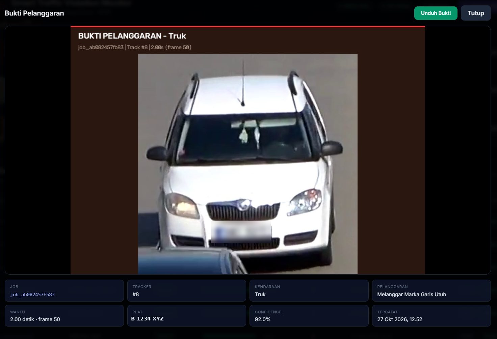

# 🚦 Smart Traffic Violation & ALPR

Turn recorded traffic video into explainable violation evidence: detect and
track vehicles, check whether they cross a forbidden zone, read the licence
plate from multiple frames, and produce a human-reviewable evidence image plus
an annotated video.

Built as a practical homelab project: one FastAPI process, one SQLite file, one
in-process worker, YOLO11 + ByteTrack, fast-alpr on ONNX, and Caddy + Cloudflare
Tunnel in front. It runs on a 4 GB GTX 1050 Ti.

> **Honesty rule.** A plate is shown as OCR output only when it was actually read
> from the video (`plate_source=real`). Simulated and legacy rows are labelled
> and excluded from the headline statistics. The evidence image says
> `HASIL OCR`, `PLAT SIMULASI`, or `PLAT TIDAK TERBACA` — it never invents a plate
> and presents it as fact.

---

## Demo

[](docs/assets/screenshots/evidence-detail.png)

[▶ Watch the annotated demo (720p, 1.3 MB)](docs/assets/videos/demo-detection-720p.mp4) ·
[Download the synthetic input clip](docs/assets/videos/sample-traffic.mp4)

The repository ships an anonymised demo database: **3 completed jobs, 10
violations, 20 redacted evidence images**. Every plate number is synthetic and
every plate pixel in the images is blurred. Raw footage is never committed.

Reference deployment (basic auth, not a public demo):
`https://trafic-detection.abdulrosyid.my.id`

---

## Features

- **Upload once, process asynchronously.** MP4/AVI/MKV/MOV/M4V, streamed and
  size-limited.
- **Draw the zone on the video.** Click the frame to add polygon points, drag to
  adjust, import/export JSON, or load a demo zone.
- **YOLO11 + ByteTrack.** COCO `car`, `motorcycle`, `bus`, `truck`, persistent
  tracker IDs, adaptive inference resolution (640 → 960 → 1280 for 4K).
- **Explainable violation logic.** Supervision `PolygonZone` with a
  `BOTTOM_CENTER` anchor — the tyre contact point, not the box centre.
- **Multi-frame ALPR.** Up to 6 best crops per vehicle, scored by area and
  Laplacian sharpness; per-character confidence-weighted voting across frames.
- **Honest provenance.** `real` / `simulated` / `unreadable` per violation,
  `real` / `simulated` / `legacy` per job, with a verification flag.
- **Evidence you can audit.** Fixed-layout JPEG with vehicle crop, plate
  thumbnail, OCR headline, confidence, frame, and timestamp.
- **Browser-playable output.** H.264 via ffmpeg, `+faststart`, no audio.
- **Dashboard included.** Live progress, history, search, filters, CSV export,
  and a video modal. Tailwind and fonts are served locally, no CDN.
- **Deploy behind one door.** Cloudflare Tunnel → Traefik → Caddy → app, no
  inbound ports. Caddy does basic auth, body limits, CSP, and `no-store`.
- **Tested.** API lifecycle, geometry, plate normalisation, and consensus voting.

---

## Architecture

```text
Browser
  │  HTTPS
  ▼
Cloudflare edge ── Tunnel ──► Traefik :80 ──► Caddy :80 ──► FastAPI :8000
                                                           │
                                                           ├─ SQLite (WAL)
                                                           ├─ in-process worker
                                                           ├─ YOLO11 + ByteTrack
                                                           ├─ PolygonZone
                                                           └─ fast-alpr (ONNX)
```

| Layer | Technology |
|---|---|
| API | FastAPI + Pydantic |
| Database | SQLite + SQLAlchemy, WAL mode |
| Queue | `queue.Queue` + one daemon thread (one job at a time) |
| Detection | Ultralytics YOLO11n |
| Tracking | ByteTrack |
| Geometry | OpenCV + Supervision |
| ALPR | fast-alpr: `yolo-v9-t-384-license-plate-end2end` + `cct-s-v2-global-model` |
| Video | OpenCV + ffmpeg (`imageio-ffmpeg`) |
| Edge auth | Caddy basic auth (bcrypt) |
| Public entry | Cloudflare Tunnel |

---

## Quick start

### Docker, GPU (recommended)

```bash
cp .env.docker.example .env
chmod 600 .env

# Generate a bcrypt hash for the dashboard password.
docker run --rm caddy:2-alpine caddy hash-password --plaintext 'choose-a-strong-password'
# Put BASIC_AUTH_USER and the single-quoted bcrypt hash in .env.

docker compose -f docker-compose.yml -f docker-compose.gpu.yml up -d --build
```

Open <http://127.0.0.1:8011> and log in.

### Docker, CPU

```bash
docker compose up -d --build
```

### Local Python

```bash
python3.12 -m venv .venv
source .venv/bin/activate
pip install -r requirements.txt

# Demo mode: no model download, no GPU.
MOCK_PIPELINE=1 MOCK_OCR=1 uvicorn api:app --host 127.0.0.1 --port 8000
```

Then upload [`docs/assets/videos/sample-traffic.mp4`](docs/assets/videos/sample-traffic.mp4)
and press **Isi Zona Demo**.

### Load the demo dataset

```bash
docker compose stop app
docker run --rm \
  -v "$PWD/seed:/seed:ro" \
  -v traffic-alpr_app_data:/data \
  --entrypoint python \
  traffic-alpr:gpu /app/scripts/load_seed.py --seed /seed --force
docker compose start app
```

Use `traffic-alpr:latest` instead of `traffic-alpr:gpu` on a CPU-only install.

---

## How it works

1. **Upload** — the video is validated, probed, and queued; the polygon is
   clamped to the actual frame size.
2. **Detect + track** — YOLO11 finds vehicles, ByteTrack keeps an ID per vehicle.
3. **Check the zone** — the bottom-centre of each box is tested against the
   polygon; vehicles inside are marked as violators.
4. **Sample + ALPR** — the largest/sharpest crops per track are read, then
   voted per character. Low confidence or low agreement becomes
   `TIDAK TERBACA`, not a guess.
5. **Prove it** — the best crop and plate result become an evidence JPEG; the
   annotated frames become an H.264 MP4.

The API stores a snapshot of the configuration used for each job (`mode`,
`imgsz`, `model_weights`, `alpr_engine`, mock flags), so history stays
interpretable after you change the server.

---

## API at a glance

| Method | Path | Purpose |
|---|---|---|
| `GET` | `/health` | DB + worker + model mode |
| `POST` | `/api/v1/jobs` | upload video + polygon + classes |
| `GET` | `/api/v1/jobs` | list jobs (`status`, `limit`, `offset`) |
| `GET` | `/api/v1/jobs/{id}` | job progress and output URL |
| `GET` | `/api/v1/violations` | list rows (`job_id`, `limit`, `offset`) |
| `GET` | `/api/v1/violations/{id}` | one row with evidence URLs |
| `GET` | `/api/v1/stats` | headline counts + provenance split |
| `GET` | `/docs` | OpenAPI UI (behind basic auth) |

```bash
curl -u operator:password \
  -F "file=@docs/assets/videos/sample-traffic.mp4" \
  -F 'zone_coordinates=[[250,500],[1030,500],[1120,700],[160,700]]' \
  -F 'target_classes=[2,3,5,7]' \
  http://127.0.0.1:8011/api/v1/jobs
```

```json
{
  "job_id": "job_4f1f8d6c44c3",
  "status": "PENDING",
  "message": "Video berhasil diunggah dan masuk antrean pemrosesan."
}
```

Full request/response examples, error cases, and the stats semantics are in
[`docs/end-to-end.md`](docs/end-to-end.md#10-http-api).

---

## Performance

Measured on the reference machine (GTX 1050 Ti 4 GB, Pascal `sm_61`):

| Workload | Result |
|---|---|
| YOLO11n detection, `imgsz=960`, warm | ~0.025 s/frame (~40 FPS) |
| VRAM: tensors / peak process | ~92 MB / ~667 MiB |
| 120-frame end-to-end test | ~13 s |
| 538-frame 4K clip, `imgsz=1280`, CPU ALPR | ~7.5 min |
| Public request through the tunnel | ~160 ms, HTTP/2 |

ALPR runs on CPU on this GPU because the available `onnxruntime-gpu` build does
not provide `sm_61` kernels. Newer GPUs can set `OCR_GPU=true`.

---

## Project layout

```text
api.py worker.py pipeline.py alpr.py geometry.py video_io.py
models.py database.py config.py schemas.py index.html
static/          local Tailwind + fonts + dashboard assets
docker/          Caddyfile, pinned requirements, model warmup
docker-compose*  base, GPU, homelab, direct-LAN overlays
docs/            end-to-end guide, deployment guides, archive, assets
seed/            anonymised demo DB + redacted evidence
scripts/         seed builder/loader, sample generator, ALPR eval
tests/           API, geometry, plate normalization/consensus
```

---

## Documentation

| Document | Language | Contents |
|---|---|---|
| [`docs/end-to-end.md`](docs/end-to-end.md) | English | full walkthrough: data model, YOLO tuning, ALPR, API, dashboard, deploy, security, performance, limits |
| [`docs/deploy-docker.md`](docs/deploy-docker.md) | Indonesian | single-host Docker + Cloudflare Tunnel |
| [`docs/deploy-homelab.md`](docs/deploy-homelab.md) | Indonesian | Traefik + shared Cloudflare Tunnel, GPU tuning, backups |
| [`SECURITY.md`](SECURITY.md) | English | vulnerability reporting + hardening checklist |
| [`docs/archive/original-spec.md`](docs/archive/original-spec.md) | Indonesian | first-iteration spec, kept for history |

---

## Testing

```bash
pytest -q
```

The suite covers upload validation and the job lifecycle, polygon parsing and
containment, plate normalisation, formatting, multi-frame consensus, and
rejection of non-plate text.

```text
tests/test_api.py        API + storage isolation
tests/test_geometry.py   polygon math
tests/test_plate.py      normalisation + voting
tests/conftest.py        temp DB/storage fixtures
```

There is no CI; verification is local by design. See
[`docs/end-to-end.md#16-tests-and-verification`](docs/end-to-end.md#16-tests-and-verification)
for the manual checks (secret scan, ignore rules, Compose validity, GPU sanity).

---

## Security and privacy

- Only the bcrypt hash of the dashboard password is stored.
- Caddy enforces basic auth and sets `Cache-Control: private, no-store`, CSP,
  `X-Frame-Options: DENY`, and `nosniff`.
- The app and Caddy publish no public ports; Cloudflare Tunnel is the only entry.
- Containers run as uid `10001` with `no-new-privileges`; no Docker socket.
- Upload limit: keep `MAX_UPLOAD_MB` ≤ `CADDY_MAX_BODY` ≤ 100 MB.
- The public demo data contains no real plates: strings are synthetic, evidence
  pixels are blurred, and raw footage is git-ignored.

Before exposing a deployment, work through the checklist in
[`SECURITY.md`](SECURITY.md).

---

## Known limits

- One shared credential, no per-user audit trail. Use Cloudflare Access for that.
- One job at a time, one app process, SQLite. No horizontal scaling.
- No delete/retention API yet; prune files manually and back up first.
- One violation type: presence in a solid-line polygon, no direction check.
- No speed, red-light, or multi-camera logic.
- Plate patterns are tuned for Indonesian and Czech-style/generic plates.
- Night, rain, extreme angles, and very distant plates become `unreadable`.

The roadmap (per-user auth, retention, directional crossing, RTSP, PostgreSQL,
speed estimation, metrics) is in
[`docs/end-to-end.md#17-known-limits-and-roadmap`](docs/end-to-end.md#17-known-limits-and-roadmap).

---

## License

MIT — see [`LICENSE`](LICENSE).

Do not add real footage, real plate numbers, or production databases to this
repository. The demo seed is synthetic on purpose.
