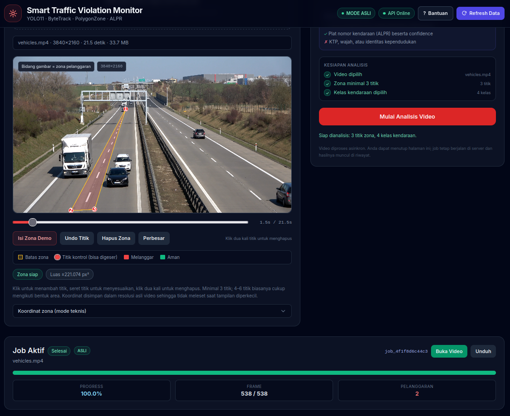
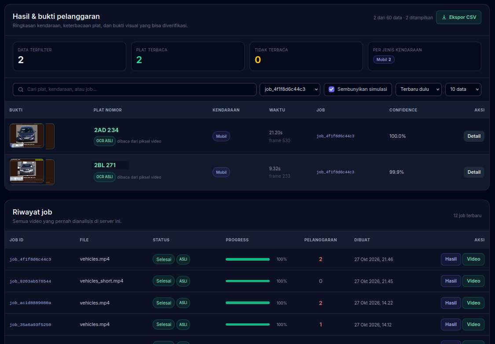
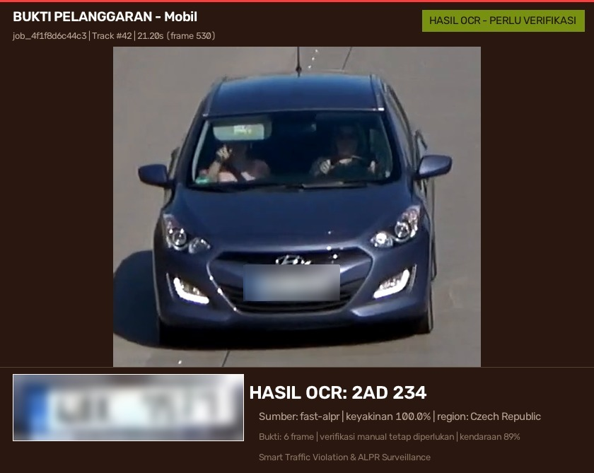

# End-to-End Guide: Smart Traffic Violation & ALPR

This document walks through the whole system: the stack, the data model, the
computer-vision pipeline, the ALPR consensus logic, the HTTP API, the dashboard,
the anonymised demo dataset, deployment, security, measured performance, and the
known limits. It is the long-form companion to the [README](../README.md).

The short version: a video goes in, vehicles are detected and tracked, the
system checks whether they cross a user-drawn forbidden zone, reads the licence
plate from several frames, and produces a red-flag row in the database plus a
human-readable evidence image and an annotated video.

---

## 1. What the system does

| Step | Input | Output |
|---|---|---|
| Upload | MP4/AVI/MKV/MOV/M4V + polygon zone | job row in `PENDING` |
| Detect | video frames | YOLO11 vehicle boxes + ByteTrack IDs |
| Check zone | box bottom-centre vs polygon | violating track IDs |
| Sample | vehicle crops from the best frames | up to 6 crops per track |
| ALPR | crops | one consensus plate + confidence |
| Evidence | best crop + plate result | JPEG with header/footer and plate thumbnail |
| Render | annotated frames | H.264 MP4 |
| Serve | database + files | API + dashboard |

The violation type is deliberately narrow and explainable: **crossing a solid
lane marking**, represented by a polygon drawn by the operator. The system does
not claim to detect every traffic offence.

---

## 2. Stack and architecture

```text
Browser
  │  HTTPS (Cloudflare edge)
  ▼
cloudflare-tunnel            one public entry point, no router port-forward
  │  http://traefik:80
  ▼
Traefik                      homelab reverse proxy (routing only)
  │  http://caddy:80
  ▼
Caddy                        basic auth, body limit, CSP, private cache headers
  │  http://app:8000
  ▼
FastAPI (uvicorn, 1 worker)
  ├── SQLAlchemy + SQLite (WAL)
  ├── in-process worker thread (one job at a time)
  ├── OpenCV + Ultralytics YOLO11 + ByteTrack
  ├── Supervision PolygonZone
  └── fast-alpr (ONNX plate detector + plate OCR)
```

| Layer | Choice | Why |
|---|---|---|
| API | FastAPI + Pydantic | typed request/response, automatic OpenAPI |
| Database | SQLite in WAL mode | zero-ops for a single-node homelab |
| Queue | `queue.Queue` + one daemon thread | no broker to operate; one GPU job at a time |
| Detection | Ultralytics YOLO11n | small COCO model, good speed on a 4 GB GPU |
| Tracking | ByteTrack (`bytetrack.yaml`) | persistent IDs without a second model |
| Zone test | Supervision `PolygonZone` | point-in-polygon with `BOTTOM_CENTER` anchor |
| ALPR | fast-alpr ONNX | local, CPU-friendly, no cloud OCR |
| Evidence | OpenCV drawing | deterministic layout, no headless browser |
| Encoding | ffmpeg via `imageio-ffmpeg` | browser-compatible H.264 |
| Edge auth | Caddy `basic_auth` | one credential before any app route |
| Public entry | Cloudflare Tunnel | no inbound ports, TLS at the edge |

### Why one worker

The job queue, model cache, and SQLite connection live inside the API process.
Running `uvicorn --workers 2` or `docker compose up --scale app=2` would give two
independent queues writing to the same SQLite file, and would load the model
twice into VRAM. The Dockerfile pins `--workers 1` for this reason.

### Why SQLite

The workload is a single writer and a handful of readers. WAL mode keeps the
dashboard responsive while a job commits progress. The schema is small and easy
to inspect with `sqlite3`. PostgreSQL is a sensible upgrade if you ever need
multiple workers or multiple hosts; the SQLAlchemy models are portable.

---

## 3. Repository layout

```text
.
├── api.py                  FastAPI app, upload endpoint, stats, static mounts
├── worker.py               single in-process job queue + stale-job recovery
├── pipeline.py             detection, tracking, zone logic, sampling, render
├── alpr.py                 plate normalisation, OCR, consensus, evidence image
├── geometry.py             polygon parsing, clamping, area, point-in-polygon
├── video_io.py             probing + H.264 writer (ffmpeg, mp4v fallback)
├── models.py               SQLAlchemy Job / Violation tables
├── database.py             engine, WAL pragmas, lightweight migrations
├── config.py               environment settings and adaptive imgsz
├── schemas.py              Pydantic response models
├── index.html              single-page dashboard (Indonesian UI)
├── static/                 local Tailwind build, fonts, dashboard JS/CSS
├── docker/
│   ├── Caddyfile           basic auth, limits, security headers
│   ├── requirements.txt    pinned production dependencies
│   └── warmup_models.py    downloads YOLO + ONNX models at build time
├── docker-compose*.yml     base, GPU overlay, homelab overlay, LAN overlay
├── docs/
│   ├── end-to-end.md       this guide
│   ├── deploy-docker.md    Indonesian deployment guide (single host)
│   ├── deploy-homelab.md   Indonesian homelab guide (Traefik + Tunnel)
│   ├── model-evaluation.md metrics, COCO sanity check, domain evaluation
│   ├── training.md         fine-tuning workflow and class-ID mapping
│   ├── archive/            original specification, kept for history
│   └── assets/             sanitised screenshots and compressed videos
├── seed/
│   ├── demo.db             anonymised SQLite database (3 jobs)
│   └── evidence/           redacted evidence images
├── scripts/
│   ├── load_seed.py        install the demo dataset into a volume
│   ├── make_demo_seed.py   rebuild the anonymised dataset from a live DB
│   ├── make_sample_video.py synthetic CCTV clip generator
│   ├── eval_yolo.py        detection evaluation (P/R/F1, mAP, plots)
│   ├── train_yolo.py       fine-tuning wrapper with a reproducibility report
│   └── eval_alpr.py        generic ALPR accuracy harness
├── configs/
│   ├── traffic-data.example.yaml   four-class fine-tuning template
│   └── coco-val2017.example.yaml   COCO val2017 evaluation template
└── tests/                  API, geometry, plate normalisation/consensus
```

---

## 4. Running locally

### 4.1 Requirements

- Python 3.12
- 4 GB RAM minimum for CPU mode; an NVIDIA GPU is optional
- `ffmpeg` is **not** required on the host: `imageio-ffmpeg` ships a binary
- For Docker: Docker Engine + Compose v2.24 or newer (`!override` support)

### 4.2 Virtual environment

```bash
python3.12 -m venv .venv
source .venv/bin/activate
pip install -r requirements.txt
```

On Windows PowerShell:

```powershell
py -3.12 -m venv .venv
.\.venv\Scripts\Activate.ps1
pip install -r requirements.txt
```

### 4.3 Demo mode (no model download, no GPU)

Demo mode replaces the detector and OCR with deterministic fakes, so the whole
flow can be exercised offline:

```bash
MOCK_PIPELINE=1 MOCK_OCR=1 uvicorn api:app --host 127.0.0.1 --port 8000
```

Open <http://127.0.0.1:8000>, upload
`docs/assets/videos/sample-traffic.mp4`, and use **Isi Zona Demo**
(`[[250,500],[1030,500],[1120,700],[160,700]]`).

### 4.4 Real mode

```bash
uvicorn api:app --host 127.0.0.1 --port 8000
```

The first run downloads `yolo11n.pt` and the fast-alpr ONNX models. Vehicle
detection uses the GPU when `DEVICE=0` (or `cuda`) and falls back to CPU when
`DEVICE=cpu`. ALPR is controlled separately by `OCR_GPU`.

### 4.5 Environment variables

Copy `.env.example` to `.env` and adjust. The important ones:

| Variable | Default | Meaning |
|---|---|---|
| `STORAGE_DIR` | `storage` | root for uploads, evidence, output videos, DB |
| `DATABASE_URL` | SQLite under storage | SQLAlchemy URL |
| `MODEL_WEIGHTS` | `yolo11n.pt` | Ultralytics weights |
| `DEVICE` | `cpu` | `cpu`, `0`, `cuda` |
| `OCR_GPU` | `false` | fast-alpr ONNX providers |
| `IMGSZ` | empty (adaptive) | inference resolution; empty = adapt to video width |
| `FRAME_STRIDE` | `1` | process every Nth frame (2 = faster, fewer samples) |
| `CONF_THRESHOLD` | `0.35` | vehicle confidence |
| `IOU_THRESHOLD` | `0.5` | NMS IoU |
| `ALPR_MAX_SAMPLES` | `6` | crops kept per violating track |
| `OCR_CONF_THRESHOLD` | `0.35` | below this the plate is `unreadable` |
| `MAX_UPLOAD_MB` | `95` in Docker | application upload limit |
| `CORS_ORIGINS` | `*` | comma-separated exact origins in production |
| `MOCK_PIPELINE` / `MOCK_OCR` | `0` | simulation flags; never `1` in production |

`STORAGE_DIR` and `DATABASE_URL` are forced to `/data` by the Compose file so a
stray host `.env` cannot write outside the volume.

---

## 5. Data model and plate provenance

### 5.1 Tables

`jobs`

| Column | Purpose |
|---|---|
| `id` | `job_` + 12 hex characters |
| `original_filename`, `stored_path` | upload metadata |
| `status` | `PENDING`, `PROCESSING`, `COMPLETED`, `FAILED` |
| `progress`, `processed_frames`, `total_frames` | live progress |
| `fps`, `width`, `height` | probed video metadata |
| `zone_coordinates` | JSON polygon, clamped to the video |
| `target_classes` | COCO class IDs |
| `output_path` | relative path of the annotated MP4 |
| `mode` | `real`, `simulated`, or `legacy` |
| `mock_ocr`, `mock_pipeline` | snapshot of the flags at job creation |
| `imgsz`, `model_weights`, `alpr_engine` | snapshot of the configuration |
| `created_at`, `started_at`, `finished_at` | timestamps |

`violations`

| Column | Purpose |
|---|---|
| `job_id`, `tracker_id` | unique per job and track |
| `vehicle_type` | `Mobil`, `Motor`, `Bus`, `Truk` |
| `frame_number`, `time_seconds` | where the best crop came from |
| `license_plate` | formatted display value, or `TIDAK TERBACA` |
| `ocr_confidence` | confidence of the consensus |
| `plate_source` | `real`, `simulated`, `unreadable` |
| `plate_raw` | raw OCR text before formatting |
| `plate_format` | `id`, `cz`, `generic` |
| `plate_region` | region hint when the engine provides one |
| `ocr_engine` | `fast-alpr`, `easyocr`, `mock` |
| `plate_crop_path` | enlarged plate thumbnail |
| `vehicle_confidence` | YOLO confidence of the selected crop |
| `needs_verification` | low confidence or non-real source |
| `proof_image_path` | evidence JPEG |

### 5.2 The honesty rule

This project had an earlier iteration that printed a **simulated** plate on
evidence images as if it were OCR output. That is worse than a miss: it turns a
demo into a false accusation. The current schema makes provenance explicit:

- `plate_source=real` — characters came from pixels in the uploaded video.
- `plate_source=simulated` — mock/demo data, never presented as fact.
- `plate_source=unreadable` — the engine saw no plate it could trust.
- `mode=legacy` — rows created before provenance existed. They are kept for
  history but excluded from the main statistics.

Consequences:

- The API only reports `readable_plates` / `unreadable_plates` for non-legacy
  jobs, and reports `simulated_violations`, `legacy_jobs`, and
  `legacy_violations` separately.
- The dashboard shows an `ASLI` / `SIMULASI` / `LEGACY` chip per job and a
  **Sembunyikan simulasi** filter.
- The evidence image says `HASIL OCR`, `PLAT SIMULASI`, or `PLAT TIDAK TERBACA`.
  It never dresses a mock value as a reading.
- Confidence is only meaningful for `real` rows; the UI de-emphasises it
  otherwise.

### 5.3 Data cleaning performed for this repository

The public repository must not contain real plate data. The following steps were
taken, and can be reproduced:

1. Failed jobs and their orphaned uploads were deleted.
2. Legacy simulated rows were marked `mode=legacy` instead of being silently
   mixed into current statistics.
3. Three newest **real** completed jobs were selected for the demo seed.
4. Every plate string was replaced with a deterministic synthetic value that
   matches the original format (`B 1234 XYZ`, `4AB 2345`, or a generic value).
5. Evidence images were rebuilt: the plate region detected by the ALPR detector
   was pixelated and blurred, the plate thumbnail was destroyed, and the
   headline was redrawn with the synthetic value.
6. `stored_path` was cleared and `output_path` set to `NULL`, so the seed has no
   dangling links to private uploads or videos.
7. Raw sample footage is git-ignored; only compressed, checked clips under
   `docs/assets/videos/` are published.

`seed/demo.db` contains **3 jobs, 10 violations, all `plate_source=real`, and 20
redacted evidence images** (10 proof images + 10 plate thumbnails). It has no
orphan violations.

To rebuild the seed from a live installation:

```bash
docker run --rm -i \
  -v "$PWD:/work" \
  -v traffic-alpr_app_data:/data:ro \
  --entrypoint python \
  traffic-alpr:gpu /work/scripts/make_demo_seed.py \
    --out /work/seed --jobs 3
```

To install it into a stopped stack:

```bash
docker compose stop app
docker run --rm \
  -v "$PWD/seed:/seed:ro" \
  -v traffic-alpr_app_data:/data \
  --entrypoint python \
  traffic-alpr:gpu /app/scripts/load_seed.py --seed /seed --force
docker compose start app
```

---

## 6. Detection and tracking

### 6.1 Classes

`DEFAULT_CLASSES = [2, 3, 5, 7]` — COCO `car`, `motorcycle`, `bus`, `truck`.
The dashboard lets the operator toggle each class. A pedestrian or bicycle is
not a vehicle for this violation type.

### 6.2 Inference resolution

`config.adaptive_imgsz()` scales the inference letterbox to the source video:

| Source width | `imgsz` |
|---|---|
| ≥ 2560 px (4K) | 1280 |
| ≥ 1600 px | 960 |
| < 1600 px | 640 |

An explicit `IMGSZ` always wins. The default 640 is too coarse for a 4K highway
shot: distant cars become a few pixels and are missed or misclassified. Raising
it to 1280 keeps small vehicles detectable, at the cost of GPU time and VRAM.

### 6.3 Tracker

`YoloDetector.detect()` calls:

```python
model.track(
    source=frame,
    persist=True,
    classes=classes,
    conf=0.35,
    iou=0.5,
    imgsz=imgsz,
    tracker="bytetrack.yaml",
    device=device,
    verbose=False,
)
```

`persist=True` keeps tracker state between calls, which is what gives a car the
same `tracker_id` across frames. ByteTrack needs the `lap` linear-assignment
solver; missing it produces `No module named 'lap'` at runtime. It is pinned in
`docker/requirements.txt`.

### 6.4 Tuning notes

- **`conf=0.35`** is a compromise: lower values produce more distant-vehicle
  boxes but also more false positives on guardrails and shadows.
- **`iou=0.5`** works well for separated road traffic; raise it only if vehicles
  overlap heavily.
- **`FRAME_STRIDE=2`** halves processing time and still gives enough samples for
  ALPR, at the risk of missing a very brief zone crossing.
- **`IMGSZ`** is the biggest quality lever. Measure VRAM before raising it; a
  4 GB card cannot run YOLO11x at 1280 in this stack.
- The annotated video is written at the **source** resolution, independent of
  `imgsz`; inference resolution does not degrade the output frame.

---

## 7. Violation logic

### 7.1 Polygon input

`zone_coordinates` is a JSON array of `[x, y]` points in **source-video pixel
coordinates**:

```json
[[250, 500], [1030, 500], [1120, 700], [160, 700]]
```

Validation (`geometry.py`):

- at least 3 points;
- every point is a finite, non-negative `[x, y]`;
- area ≥ 100 px²;
- after clamping to the probed frame size, area is still ≥ 100 px².

The dashboard draws the polygon directly over a video frame, so the operator does
not have to guess coordinates. Points can be moved, undone, reset, or pasted as
JSON.

### 7.2 Anchor point

Supervision's `PolygonZone` is configured with
`triggering_anchors=[sv.Position.BOTTOM_CENTER]`. The bottom-centre of a vehicle
box is a proxy for where the tyres meet the road. Using the box centre would
flag a car whose roof overhangs the zone but whose wheels have not crossed the
line.

### 7.3 What counts as a violation

For each processed frame:

1. Run detection + tracking.
2. Ask the zone which detections fall inside.
3. Keep the track IDs that are inside.
4. Keep the largest vehicle crop seen for each track (the frame where the plate
   is likely biggest and sharpest).
5. At the end of the video, one row per violating track is written.

The current model flags **entry into the zone**, not a directional crossing.
A vehicle parked inside the polygon for the whole clip is still reported. This
is a deliberate simplification: direction-aware line crossing needs a second
geometry layer and is on the roadmap.

### 7.4 Duplicate suppression

`violations` has `UNIQUE(job_id, tracker_id)`. A car that stays in the zone for
200 frames produces one row, not 200. If the tracker loses and re-acquires the
same car with a new ID, it can appear twice; that is a tracker limitation, not a
database one.

---

## 8. ALPR

### 8.1 Engine

Production uses `fast-alpr` with ONNX models:

| Role | Model |
|---|---|
| Plate detector | `yolo-v9-t-384-license-plate-end2end` |
| Plate OCR | `cct-s-v2-global-model` |

EasyOCR remains available as a fallback (`OCR_ENGINE=easyocr`), but it is not
installed in the production image by default. The fast-alpr path is smaller,
faster, and gives a plate crop plus a confidence score directly.

### 8.2 Multi-frame sampling

Reading one frame is brittle: motion blur, glare, and compression can destroy a
character. The pipeline keeps up to `ALPR_MAX_SAMPLES` crops per violating track,
scored by:

```text
sqrt(crop_width * crop_height) * log1p(min(laplacian_variance, 5000))
```

The first term rewards a large vehicle (bigger plate in pixels); the second
rewards sharp edges. The best samples are not necessarily consecutive frames.

### 8.3 Normalisation

`normalize_plate_text()`:

1. Uppercases and strips separators.
2. Accepts the Indonesian pattern `1–2 letters + 1–4 digits + 0–3 letters`
   (`B 1234 XYZ`).
3. Tries ambiguous-character corrections (`0↔O`, `1↔I`, `5↔S`, `8↔B`, `2↔Z`,
   `6↔G`, `7↔T`) and keeps the variant closest to the raw reading.
4. Accepts a generic 5–9 character plate with at least 2 letters and 2 digits.
   This is what allows Czech-style `4AB 2345` without forcing an Indonesian
   pattern.
5. Rejects logos and short noise such as `MAN`, `ZAKO`, or `1234`.

`format_plate()` only changes presentation:

| Compact | Display |
|---|---|
| `B1234XYZ` | `B 1234 XYZ` |
| `4AB2345` | `4AB 2345` |
| `TIDAK TERBACA` | `TIDAK TERBACA` |

### 8.4 Consensus voting

For each track, every sample is read, then `_consensus()`:

1. Keep only `plate_source=real` readings.
2. Group by character length; pick the length with the most support (ties go to
   the higher total confidence).
3. Vote **per character position**, weighting each vote by that reading's
   confidence.
4. If the voted string is not plate-like, fall back to the single highest
   confidence reading.
5. Compute `agreement = exact_matches / group_size`.
6. If confidence `< OCR_CONF_THRESHOLD` (0.35) or agreement `< 0.34`, mark the
   plate `unreadable`.

Why the agreement check: per-character voting can invent a string that no single
frame ever produced. If no frame supports the complete result, the honest answer
is "unreadable", not a plausible-looking guess.

### 8.5 Verification flag

A row gets `needs_verification=true` when:

- the plate is not `real`, or
- consensus confidence `< 0.70`, or
- the selected vehicle crop confidence `< 0.75`.

`simulated` rows are exempt because they are demo data, not claims about
reality. The dashboard shows a warning badge for rows that need a human check.

### 8.6 CPU vs GPU

`OCR_GPU=false` forces ONNX Runtime's CPU provider. This is the correct setting
for older Pascal GPUs (for example a GTX 1050 Ti, compute capability `sm_61`),
because the available `onnxruntime-gpu` build does not provide `sm_61` kernels.
YOLO still uses the GPU; only ALPR runs on the CPU. On a modern GPU,
`OCR_GPU=true` can move the plate models to CUDA.

### 8.7 Honest failure

If no plate is detected, the row still exists — the vehicle did cross the zone.
It is stored as:

```text
license_plate = "TIDAK TERBACA"
plate_source  = "unreadable"
ocr_confidence = 0.0
```

That is useful operational data. Hiding the row would understate the violation
count; inventing a plate would be worse.

---

## 9. Evidence image and annotated video

### 9.1 Evidence JPEG

`alpr.build_evidence_image()` composes a fixed layout:

```text
┌──────────────────────────────────────────────┐
│ JOB job_…  |  TRACK #4  |  Mobil             │  66 px header
├──────────────────────────────────────────────┤
│                                              │
│            best vehicle crop                 │
│                                              │
├──────────────────────────────────────────────┤
│ [plate thumbnail]  HASIL OCR: B 1234 XYZ     │ 150 px footer
│                    conf 0.98 · fast-alpr     │
│                    frame 50 · 2.00 s         │
└──────────────────────────────────────────────┘
```

The footer changes with provenance:

- `HASIL OCR: <plate>` for `real`
- `PLAT SIMULASI: <plate>` for `simulated`
- `PLAT TIDAK TERBACA` for `unreadable`
- a verification badge when `needs_verification` is true

The plate thumbnail is saved separately (`*_plate.jpg`) and enlarged with
Lanczos if it is narrower than 360 px.

The evidence example in §11 is sanitised: plate pixels are blurred in both the
photo and the thumbnail, and the OCR headline is a synthetic placeholder. The
original image is not in the repository.

### 9.2 Annotated video

`pipeline._annotate_frame()` draws:

- the forbidden polygon (orange, 18% fill, 2 px outline);
- green boxes for tracked vehicles;
- red boxes and `PELANGGARAN` labels for violating tracks;
- a top bar with job ID, frame number, unique violator count, and current
  in-zone count;
- a `MOCK MODE` suffix if the pipeline is simulated.

`video_io.VideoWriter` pipes raw BGR frames to ffmpeg:

```text
libx264, preset veryfast, crf 23, yuv420p, +faststart, no audio
```

The result plays in Chrome/Firefox/Safari without a plugin. If `imageio-ffmpeg`
is unavailable, it falls back to OpenCV's `mp4v`, which some browsers refuse to
play. The container image always ships the ffmpeg binary.

---

## 10. HTTP API

All routes are protected by Caddy basic auth in the Docker deployment. The API
itself has no authentication layer, so do not expose uvicorn directly.

### 10.1 `GET /health`

```json
{
  "status": "ok",
  "database": true,
  "worker": true,
  "mock_pipeline": false,
  "mock_ocr": false,
  "model_weights": "yolo11n.pt",
  "device": "0",
  "imgsz": 1280,
  "imgsz_auto": true,
  "ocr_engine": "fast-alpr"
}
```

`status` becomes `degraded` if the DB ping or the worker thread fails.

### 10.2 `POST /api/v1/jobs`

`multipart/form-data`:

| Field | Required | Example |
|---|---|---|
| `file` | yes | `sample-traffic.mp4` |
| `zone_coordinates` | yes | `[[250,500],[1030,500],[1120,700],[160,700]]` |
| `target_classes` | no | `[2, 3, 5, 7]` |

```bash
curl -u operator:password \
  -F "file=@docs/assets/videos/sample-traffic.mp4" \
  -F 'zone_coordinates=[[250,500],[1030,500],[1120,700],[160,700]]' \
  -F 'target_classes=[2,3,5,7]' \
  http://127.0.0.1:8011/api/v1/jobs
```

Response `202`:

```json
{
  "job_id": "job_4f1f8d6c44c3",
  "status": "PENDING",
  "message": "Video berhasil diunggah dan masuk antrean pemrosesan."
}
```

Validation rejects:

- extensions other than `.mp4 .avi .mkv .mov .m4v` (`400`);
- empty files (`400`);
- files that OpenCV cannot decode (`400`);
- bad polygons (`400`);
- files above `MAX_UPLOAD_MB` (`413`).

The upload is streamed in 1 MiB chunks and deleted if validation fails, so a
rejected request does not leave a partial file behind.

### 10.3 `GET /api/v1/jobs`

Query parameters: `status` (optional, case-insensitive), `limit` (1–100,
default 20), `offset` (default 0).

```bash
curl -u operator:password 'http://127.0.0.1:8011/api/v1/jobs?limit=5'
```

Each item includes progress, frame counts, violation count, output URL (only if
the file exists), and the configuration snapshot.

### 10.4 `GET /api/v1/jobs/{job_id}`

Returns one job or `404`. The dashboard polls this while a job runs.

### 10.5 `GET /api/v1/violations`

Query parameters: `job_id` (optional), `limit` (1–200, default 50), `offset`.

```json
[
  {
    "id": 12,
    "job_id": "job_4f1f8d6c44c3",
    "tracker_id": 4,
    "vehicle_type": "Mobil",
    "violation_type": "Melanggar Marka Garis Utuh",
    "time_seconds": 2.0,
    "frame_number": 50,
    "license_plate": "B 1234 XYZ",
    "ocr_confidence": 0.982,
    "plate_source": "real",
    "plate_raw": "B1234XYZ",
    "plate_format": "id",
    "plate_region": "",
    "ocr_engine": "fast-alpr",
    "plate_crop_url": "/static/evidence/job_4f1f8d6c44c3_id_4_plate.jpg",
    "vehicle_confidence": 0.91,
    "needs_verification": false,
    "evidence_image_url": "/static/evidence/job_4f1f8d6c44c3_id_4.jpg"
  }
]
```

### 10.6 `GET /api/v1/violations/{id}`

One row or `404`.

### 10.7 `GET /api/v1/stats`

```json
{
  "total_jobs": 15,
  "total_violations": 10,
  "pending_jobs": 0,
  "processing_jobs": 0,
  "completed_jobs": 15,
  "failed_jobs": 0,
  "readable_plates": 10,
  "unreadable_plates": 0,
  "simulated_plates": 38,
  "simulated_violations": 38,
  "legacy_jobs": 9,
  "legacy_violations": 48,
  "vehicle_breakdown": {"Mobil": 8, "Truk": 2}
}
```

`total_violations` counts only non-legacy `real` + `unreadable` rows. Simulated
and legacy rows are reported separately so old demo data cannot inflate the
headline number.

### 10.8 Static files and docs

- `/` — dashboard (`index.html`)
- `/static/evidence/*` — evidence JPEGs
- `/static/output_videos/*` — annotated MP4s
- `/static/assets/*` — local Tailwind CSS and fonts
- `/docs` and `/redoc` — FastAPI's generated docs (basic auth only)

### 10.9 Error shape

FastAPI's standard shape:

```json
{"detail": "Zona tidak berada di dalam area video"}
```

The Caddy layer returns plain-text `401`/`413` pages before the request reaches
FastAPI.

---

## 11. Dashboard

`index.html` is a single page served by FastAPI. It uses a locally built
Tailwind stylesheet and locally served fonts, so it works without a CDN and
without an internet connection inside the container.

Main areas:

1. **Health badges** — mode (`ASLI`/`SIMULASI`), worker status, device.
2. **Upload** — drag/drop or file picker, video preview, metadata.
3. **Zone editor** — click to add points, drag to move, undo, reset, demo zone,
   JSON import/export, area readout, validation warnings.
4. **Class filter** — car, motorcycle, bus, truck.
5. **Submit** — disabled until a file, a valid zone, and at least one class are
   present.
6. **Active job card** — progress bar, frame count, violation count, live video
   link when finished.
7. **Results** — search by plate/vehicle/job, job filter, hide-simulated toggle,
   sort order, page size, vehicle chips, CSV export.
8. **History** — every job with status and mode chip.
9. **FAQ** — the system's limits in plain language.



*Upload and zone editor. The polygon is drawn on the source frame, the readiness
panel checks the file, zone, and classes, and the active-job card shows frame
progress and the violation count.*



*Results and history. Plate values and thumbnails in this screenshot are
synthetic demo data; search, job filter, hide-simulated, CSV export, and the
history table are the real controls.*



*Evidence JPEG from a real demo run. The plate is pixelated and the OCR headline
is a synthetic placeholder; the original plate is not in the repository.*

---

## 12. Demo data and sample video

### 12.1 What is published

| Asset | Size | Notes |
|---|---|---|
| `seed/demo.db` | 36 KB | 3 jobs, 10 violations, synthetic plates |
| `seed/evidence/` | ~900 KB | 20 redacted JPEGs |
| `docs/assets/videos/demo-detection-720p.mp4` | 1.3 MB | annotated output, 720p |
| `docs/assets/videos/sample-traffic.mp4` | 117 KB | synthetic input clip, 720p |
| `docs/assets/screenshots/evidence-detail.jpg` | 77 KB | sanitised evidence example |
| `docs/assets/screenshots/dashboard-upload.png` | 457 KB | upload + zone editor |
| `docs/assets/screenshots/dashboard-results.png` | 107 KB | results + history, synthetic plates |
| `docs/assets/evaluation/coco-val2017/` | ~350 KB | COCO PR/F1 curves, confusion matrix, raw CSV |

### 12.2 Sample input

`sample-traffic.mp4` is generated by `scripts/make_sample_video.py`: a synthetic
road scene with moving cars, a solid line, and a default zone. It contains no
real footage and no real plates, so it is safe to publish and useful for tests.

```bash
python scripts/make_sample_video.py
```

### 12.3 Annotated demo

[Watch the annotated 720p demo](assets/videos/demo-detection-720p.mp4) — 538
frames, 25 fps, 1.3 MB. It shows detection boxes, tracker IDs, the forbidden
polygon, and the frame counter. The source was a 4K public clip; the published
version is downscaled to 720p, and its plates are not legible at that size.

[Download the synthetic input clip](assets/videos/sample-traffic.mp4).

---

## 13. Deployment

Two Indonesian guides cover the details:

- [`deploy-docker.md`](deploy-docker.md) — single host, cloudflared on the host.
- [`deploy-homelab.md`](deploy-homelab.md) — the reference homelab, where a
  shared Traefik and a Cloudflare Tunnel already exist.

### 13.1 Compose files

| File | Role |
|---|---|
| `docker-compose.yml` | app + Caddy + named volume, CPU image |
| `docker-compose.gpu.yml` | NVIDIA reservation + CUDA image |
| `docker-compose.homelab.yml` | attaches Caddy to `homelab-network` and adds Traefik labels |
| `docker-compose.direct.yml` | exposes Caddy on the LAN for testing |

The reference stack:

```bash
docker compose \
  -f docker-compose.yml \
  -f docker-compose.gpu.yml \
  -f docker-compose.homelab.yml \
  up -d --build
```

Traefik routes by hostname:

```yaml
traefik.http.routers.traffic-alpr.rule: "Host(`${PUBLIC_HOSTNAME:?set PUBLIC_HOSTNAME in .env}`)"
```

`PUBLIC_HOSTNAME` comes from `.env`. The tunnel's public hostname points at
`http://traefik:80`; Caddy remains the only component that enforces auth.

### 13.2 First-run checklist

```bash
cp .env.docker.example .env
chmod 600 .env

# Generate a bcrypt hash; keep the single quotes around it in .env.
docker run --rm caddy:2-alpine caddy hash-password --plaintext 'choose-a-strong-password'

# Build and start
docker compose -f docker-compose.yml -f docker-compose.gpu.yml up -d --build

# Local health through Caddy (expect 401 without credentials)
curl -i http://127.0.0.1:8011/health
curl -u operator:password http://127.0.0.1:8011/health

# GPU check inside the app (no nvidia-smi in this image)
docker compose exec app python -c \
  "import torch; print(torch.cuda.is_available(), torch.cuda.get_device_name(0))"
```

The app image runs as uid `10001` and has no Docker socket. The app port is not
published at all; only Caddy binds to `127.0.0.1:8011` in the base stack.

### 13.3 Cloudflare

- One Tunnel, one public hostname.
- Service: `http://traefik:80` (homelab) or `http://localhost:8011` (single host).
- SSL/TLS mode: **Full** (or Full Strict).
- Cache Rule: **Bypass** for the hostname.
- Bot Fight Mode: off for this hostname; it interferes with basic auth.
- DNS: proxied CNAME to `<TUNNEL_ID>.cfargotunnel.com`.

No router port-forward and no second tunnel are required.

### 13.4 Upload limit

Cloudflare Free rejects request bodies over 100 MB. Keep:

```text
MAX_UPLOAD_MB (app)  ≤  CADDY_MAX_BODY (Caddy)  ≤  100 MB
```

The example uses 95 MB for the app and 100 MB for Caddy.

---

## 14. Security model

### 14.1 Authentication

Caddy validates a single basic-auth credential before proxying. Only the bcrypt
hash is stored:

```caddyfile
basic_auth {
    {$BASIC_AUTH_USER:operator} {$BASIC_AUTH_HASH}
}
```

The hash must be single-quoted in `.env`; otherwise Compose expands the `$`
characters and Caddy receives a broken hash.

### 14.2 Network exposure

- Cloudflare Tunnel is the only public entry.
- Caddy listens on `127.0.0.1:8011` in the base stack.
- The app uses `expose: 8000`, not `ports:`.
- Traefik reaches Caddy over the external `homelab-network`.
- No Docker socket is mounted.

### 14.3 Headers

Caddy sets:

```text
Cache-Control: private, no-store
X-Content-Type-Options: nosniff
X-Frame-Options: DENY
Referrer-Policy: strict-origin-when-cross-origin
Permissions-Policy: geolocation=(), microphone=(), camera=()
Content-Security-Policy: default-src 'self'; ...; frame-ancestors 'none'
-Server
```

`no-store` matters twice: it keeps violation data out of browser caches and
prevents Cloudflare from serving an authenticated response to someone else.

### 14.4 Application

- `MOCK_PIPELINE=0`, `MOCK_OCR=0` in production.
- `CORS_ORIGINS` should be the exact public origin, not `*`.
- Uploads are streamed and size-limited; extensions and decodability are checked.
- SQLite uses WAL; the app uses parameterised SQLAlchemy statements.
- Containers run as non-root uid `10001` with `no-new-privileges`.
- `/docs` exists but is behind basic auth. Disable it in `api.py` if you do not
  want it exposed at all.

### 14.5 Data handling

Video and plate data are personal data in most jurisdictions. The repository
ships only synthetic demo data. A real deployment should define:

- who may access the hostname;
- how long uploads/evidence are retained;
- how backups are encrypted;
- how a data-subject request is handled;
- whether Cloudflare Access (per-user identity) is required instead of a shared
  password.

See [`SECURITY.md`](../SECURITY.md) for the reporting policy and the full
hardening checklist.

---

## 15. Performance

Measured on the reference homelab:

| Component | Configuration | Result |
|---|---|---|
| GPU | NVIDIA GTX 1050 Ti, 4 GB, Pascal `sm_61` | CUDA available |
| Detection | YOLO11n, `imgsz=960`, warm | ~0.025 s/frame (~40 FPS) |
| VRAM | tensors / peak process | ~92 MB / ~667 MiB |
| ALPR | fast-alpr, CPU (`OCR_GPU=false`) | ~0.98 confidence on clear plates |
| End-to-end | 120-frame test clip | ~13 s |
| End-to-end | 538-frame 4K clip, `imgsz=1280` | ~1.4 min (77–82 s, 143–153 ms/frame) |
| Public request | Cloudflare edge → Traefik → Caddy | ~160 ms, HTTP/2 |

Per-stage breakdown of that 538-frame 4K run (10 violations, warm model cache):

| Stage | Total | Per frame | Share |
|---|---|---|---|
| Decode | 9.9 s | 18.3 ms | 13 % |
| YOLO detection (`track`, `imgsz=1280`) | 27.4 s | 50.7 ms | 36 % |
| Frame annotation (4K canvas) | 11.6 s | 21.4 ms | 15 % |
| Encoder backpressure (`libx264` 3840×2160) | 13.0 s | 24.1 ms | 17 % |
| CPU ALPR (post-pass, 10 vehicles / 55 crops) | 9.6 s | — | 12 % |
| DB, evidence images, model load | 5.7 s | — | 7 % |

The same job replayed inside the deployed container measured 82.4 s
(153 ms/frame); the spread comes from the production volume and database rather
than from the code. Both runs used the same clip and zone.

Interpretation:

- Detection is the largest per-frame stage (~36 %), followed by the H.264
  encoder and frame compositing. ALPR is ~12 % and scales with the number of
  violations, not with clip length.
- Annotation used to cost ~83 ms/frame because the zone and header overlays were
  blended over the whole 4K frame. Blending only inside the polygon bounding box
  and the header band produces pixel-identical output at ~21 ms/frame, which
  brings the whole job from 111 s to 77 s.
- Decoding in a background thread was measured as a wash on this 4-core CPU:
  the overlap is offset by contention with detection preprocessing, so the
  pipeline keeps the simple sequential loop.
- The output video keeps 3840×2160. Downscaling the source before upload is the
  cheapest further speedup if 4K evidence is not required; the evidence crops
  are cut from the original frame, so they stay full resolution either way.
- `FRAME_STRIDE=2` roughly halves the work, at the cost of ALPR samples and
  brief-crossing recall.
- The dashboard is a single page with small static assets; the expensive part is
  polling job status and loading evidence thumbnails.
- `scripts/bench_pipeline.py` measures decode, detection at several `imgsz`,
  annotation and encoding on any clip, and reports detection agreement relative
  to the highest resolution tested.

### 15.1 Detection accuracy (COCO sanity check)

The shipped detector is the official COCO-pretrained `yolo11n.pt`; this project
does not include a custom fine-tuning run. A reproducible COCO val2017 check
evaluates the four classes used by the pipeline (`car`, `motorcycle`, `bus`,
`truck`). It is a sanity check for the checkpoint and the evaluation harness, not
a measurement of this deployment's cameras.

| COCO id | Class | Instances | P | R | F1 | AP50 | AP50-95 |
|---:|---|---:|---:|---:|---:|---:|---:|
| 2 | car | 1,918 | 0.6914 | 0.5193 | 0.5931 | 0.5822 | 0.3719 |
| 3 | motorcycle | 367 | 0.7817 | 0.5831 | 0.6680 | 0.6738 | 0.4415 |
| 5 | bus | 283 | 0.8051 | 0.7032 | 0.7507 | 0.7720 | 0.6479 |
| 7 | truck | 414 | 0.6129 | 0.4082 | 0.4900 | 0.4764 | 0.3205 |
| — | **macro** | 2,982 | 0.7228 | 0.5534 | 0.6255 | 0.6261 | 0.4455 |

5,000 validation images; 4,952 of them carry at least one annotation. P/R/F1 are
per-class best-F1 values at each class's own threshold; AP is
threshold-independent. The macro row averages the four classes, so
`mAP50 = 0.6261`.

Truck is the weakest class, and car recall is only 0.52 at its best-F1 point:
expect missed vehicles and car/truck confusion in crowded frames. The app's
default `CONF_THRESHOLD=0.35` is above those best-F1 points, so live recall is
lower and precision higher; tune the threshold per scene.

See [`model-evaluation.md`](model-evaluation.md) for the command, weights SHA-256,
PR/F1 curves, confusion matrix, and the distinction between COCO, domain, and
ALPR metrics.

### 15.2 Domain accuracy is not measured

There is no labelled traffic validation set in the repository, so no
domain-specific F1/mAP is claimed. To measure it, label frames from your own
clips and run `scripts/eval_yolo.py`; [`training.md`](training.md) covers the
dataset layout and the class-ID mapping.

---

## 16. Tests and verification

The repository has no CI. Verification is local and intentional:

```bash
pytest -q
```

Coverage:

| File | What it checks |
|---|---|
| `tests/test_api.py` | upload validation, job lifecycle, stats, static URLs |
| `tests/test_geometry.py` | polygon parsing, clamping, area, containment |
| `tests/test_plate.py` | normalisation, formatting, consensus voting, rejection |
| `tests/conftest.py` | isolated temp storage + SQLite per test |

Additional manual checks:

```bash
# No secret or dataset is staged by accident
git check-ignore -v .env storage/violations.db samples/vehicles.mp4 \
  yolo11n.pt result_videos/

# Compose still renders after the hostname change
docker compose -f docker-compose.yml -f docker-compose.gpu.yml \
  -f docker-compose.homelab.yml config >/dev/null

# The demo DB has no orphan rows
python3 - <<'PY'
import sqlite3
c = sqlite3.connect("seed/demo.db")
print(c.execute("select count(*) from jobs").fetchone()[0], "jobs")
print(c.execute("select count(*) from violations").fetchone()[0], "violations")
print(c.execute(
    "select count(*) from violations v left join jobs j on v.job_id=j.id "
    "where j.id is null").fetchone()[0], "orphans")
PY

# GPU sanity inside the container
docker compose exec app python -c \
  "import torch; print(torch.cuda.is_available(), torch.cuda.get_device_name(0))"
```

---

## 17. Known limits and roadmap

### Limits

- **One shared credential.** No per-user login, no audit trail, no revocation
  without rotating the password. Put Cloudflare Access in front if you need
  identity.
- **No rate limiting in the app.** A client with valid credentials can queue many
  jobs.
- **One job at a time.** The worker is a single thread; a long 4K clip blocks the
  queue.
- **SQLite + one process.** No horizontal scaling.
- **No delete endpoint.** Removing a job requires database work and manual file
  cleanup.
- **One violation type.** Entry into a solid-line polygon, no direction check,
  no speed estimation, no red-light logic.
- **Plate formats.** Indonesian and Czech-style/generic patterns are recognised;
  other national formats may normalise poorly.
- **ALPR on CPU for Pascal GPUs.** Fine for a homelab; not a real-time solution
  at that hardware level.
- **No audio.** The output video is video-only.
- **No retention automation.** Uploads, evidence, and videos grow until you clean
  them.
- **Model accuracy depends on the scene.** Night, rain, extreme angles, dirty
  plates, and tiny distant vehicles will produce `unreadable` rows.
- **No domain-specific detection benchmark.** The shipped weights are
  COCO-pretrained. The published COCO val2017 check is a sanity check, not field
  accuracy; a labelled traffic validation set is still needed. See
  [`model-evaluation.md`](model-evaluation.md).

### Roadmap

1. Per-user auth / Cloudflare Access and an audit log.
2. Delete + retention endpoints with a configurable TTL.
3. Direction-aware line crossing (entry vs exit) instead of zone presence.
4. Optional PostgreSQL + external queue (Redis/RQ or Celery) for multiple workers.
5. Live RTSP ingestion with a ring buffer, instead of file upload only.
6. Speed estimation using a calibrated homography.
7. Plate allowlist / watchlist with hashed storage.
8. Region-specific plate validators (Indonesia first).
9. Prometheus metrics and structured JSON logs.
10. A small evaluation set with per-character error analysis in CI.

---

## 18. Troubleshooting

| Symptom | Cause | Fix |
|---|---|---|
| `No module named 'lap'` | ByteTrack needs the `lap` solver | `pip install lap==0.5.13`, or rebuild the image (it is in `docker/requirements.txt`) |
| Job stuck in `PROCESSING` after a restart | the process died mid-job | `recover_stale_jobs()` marks it `FAILED` on startup; re-upload if needed |
| `PENDING` jobs never start | worker thread not running | check `/health` → `worker`; restart the app |
| `Could not resolve host` right after adding DNS | resolver cached NXDOMAIN for 30 min | wait, flush the resolver, or test with DoH (`dig @1.1.1.1`) |
| `401` after setting a password | bcrypt hash expanded by Compose | wrap the hash in single quotes, recreate Caddy |
| `413` on upload | body exceeds app/Caddy/Cloudflare limit | keep `MAX_UPLOAD_MB` ≤ `CADDY_MAX_BODY` ≤ 100 MB |
| CUDA out of memory | `imgsz` too high for VRAM | lower `IMGSZ`, set `FRAME_STRIDE=2`, or use CPU |
| ALPR quietly uses CPU | `OCR_GPU=false`, or GPU build lacks `sm_61` | expected on Pascal; use CPU |
| Video will not play in the browser | ffmpeg missing, `mp4v` fallback used | install `imageio-ffmpeg`; the container image includes it |
| `database is locked` | two writers / two app containers | run exactly one app container and one uvicorn worker |
| Dashboard shows no evidence | seed loaded without images, or paths point outside storage | re-run `scripts/load_seed.py`, check `STORAGE_DIR` |
| Stats look too low | legacy/simulated rows are excluded by design | inspect `legacy_*` and `simulated_*` fields |
| Uploads fill the disk | no retention policy | prune `storage/uploads`, `storage/evidence`, `storage/output_videos`; back up the DB first |

### Collecting diagnostics

```bash
docker compose ps
docker compose logs --tail=100 app
docker compose logs --tail=100 caddy
curl -u operator:password http://127.0.0.1:8011/health
docker compose exec app python -c \
  "import torch; print(torch.cuda.is_available(), torch.cuda.get_device_name(0))"
```

---

## 19. License

MIT. See [`LICENSE`](../LICENSE).

The published demo data is synthetic. Do not add real footage, real plates, or
production databases to this repository.
