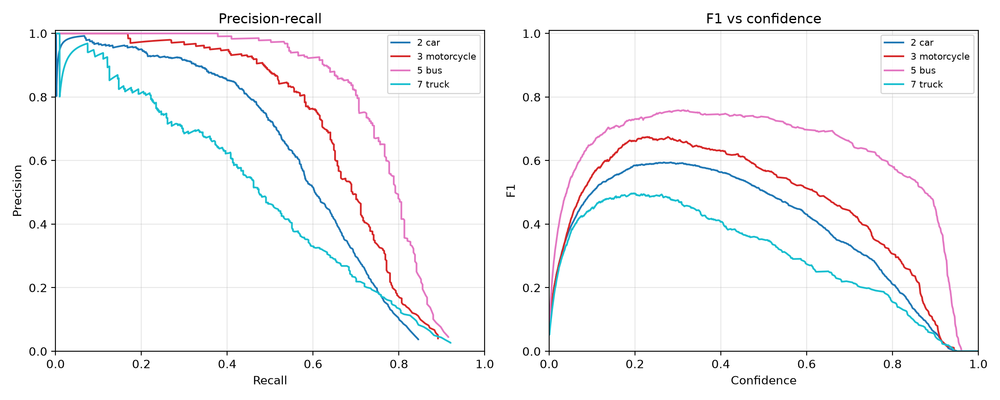
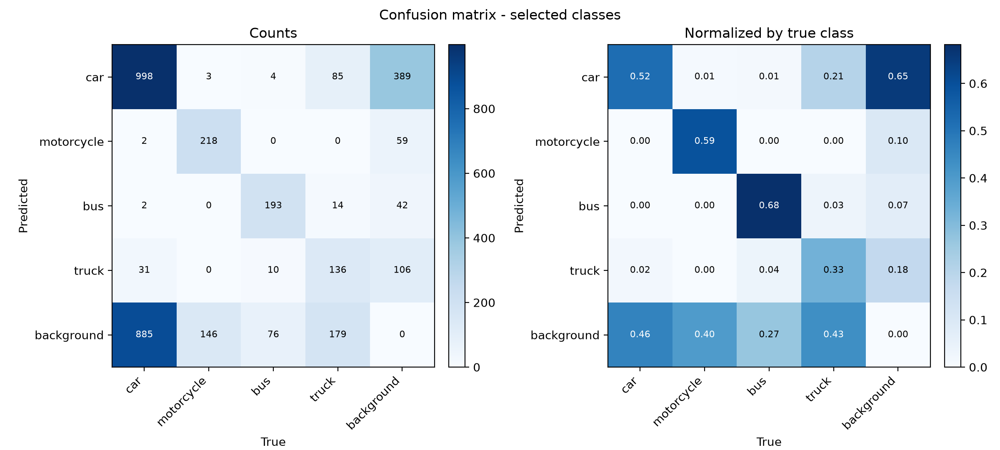

# Model evaluation

This document separates three different questions:

1. **How fast is the pipeline?** Measured on the reference GPU; see
   [Performance](end-to-end.md#15-performance).
2. **How well does the shipped detector recognise the four vehicle classes on
   COCO?** A reproducible sanity check, not field accuracy.
3. **How well does it work on this deployment's traffic scenes?** Not measured
   yet; it needs a labelled traffic validation set.

The distinction matters. A COCO number is not a traffic-accuracy claim, and F1
is not “accuracy”.

## 1. What is measured now

| Question | Status |
|---|---|
| Detection latency, VRAM, end-to-end runtime | Measured; see [Performance](end-to-end.md#15-performance) |
| COCO val2017 precision/recall/F1/mAP for car, motorcycle, bus, truck | Measured; see §4 |
| Domain-specific traffic F1/mAP | **Not measured** — no labelled traffic validation set in the repo |
| ALPR exact match / CER on a public clip | Harness available; no public clip currently passes the detector, so no number is claimed |
| End-to-end violation precision/recall | **Not measured** — needs labelled violation events, not just boxes |

## 2. Model provenance

- Weights: official Ultralytics **`yolo11n.pt`**, COCO-pretrained.
- The repository contains **no custom training run** and no fine-tuning on the
  reference deployment.
- The app filters the model to COCO classes `2` (car), `3` (motorcycle), `5`
  (bus), and `7` (truck).
- `yolo11n.pt` is git-ignored; the app downloads it at build/runtime. The COCO
  check below records the SHA-256 of the exact file used:
  `0ebbc80d4a7680d14987a577cd21342b65ecfd94632bd9a8da63ae6417644ee1`.

The shipped model is therefore a general-purpose detector, not a model trained
on this camera, this road, or this country's vehicle mix.

## 3. Metrics that matter

### Detection

- **Precision** — of the boxes the model reports, how many match a ground-truth
  box at the chosen IoU.
- **Recall** — of the ground-truth boxes, how many the model finds.
- **F1** — harmonic mean of precision and recall:
  `F1 = 2PR / (P + R)`.
  F1 depends on the confidence threshold; always report the operating point.
- **mAP50** — mean average precision at IoU 0.50, threshold-independent.
- **mAP50-95** — mean AP averaged over IoU 0.50:0.05:0.95; the primary COCO
  detection metric.
- **Confusion matrix** — counts of matched classes, background false positives,
  and missed ground truths at a fixed confidence/IoU.

Ultralytics reports precision and recall at the **best-F1 operating point**, and
each class has its own threshold. AP and the PR curve therefore use the
validation defaults (`conf=0.001`, NMS `iou=0.7`): raising `conf` would drop
low-confidence predictions and truncate recall, so mAP would depend on the
cut-off. The published confusion matrix is a **separate** pass at `conf=0.25`,
a usable operating point; at `conf=0.001` it would be dominated by tens of
thousands of background false positives.

### ALPR

- **Exact match** — the consensus plate string equals the ground truth after
  normalisation.
- **CER** — character error rate (Levenshtein distance divided by ground-truth
  length). Lower is better.

A detection mAP says nothing about OCR accuracy, and an OCR score says nothing
about vehicle detection. Report them separately.

## 4. COCO val2017 sanity check

### 4.1 Why COCO

COCO val2017 is the official holdout for the COCO-pretrained checkpoint, so:

- the weights were not trained on these 5,000 images;
- the class definitions match the model's output space;
- anyone can download the same dataset and reproduce the run.

It is **not** a traffic benchmark. COCO is mostly daylight, high-resolution,
varied scenes; the deployment is compressed 4K CCTV, often at night or in rain,
with small plates and a fixed camera angle.

### 4.2 Dataset and command

Dataset:

- `val2017.zip` — 5,000 images; 4,952 have at least one annotation.
- `annotations_trainval2017.zip` — only `instances_val2017.json` is used.
- Converted to YOLO labels with `convert_coco(..., cls91to80=True)`.

The template is [`configs/coco-val2017.example.yaml`](../configs/coco-val2017.example.yaml).
The evaluation wrapper filters **both** ground truth and predictions to the
requested class IDs, so the numbers and the compact confusion matrix describe
the four vehicle classes only. Predictions of the other 76 COCO classes are
ignored, as they are by the app at inference time.

```bash
python scripts/eval_yolo.py \
  --data configs/coco-val2017.yaml \
  --weights yolo11n.pt \
  --classes 2,3,5,7 \
  --imgsz 640 \
  --batch 8 \
  --name coco-val2017
```

The script defaults to `conf=0.001` and `iou=0.7` for AP and the PR curve, and
re-runs the validator at `conf=0.25` only for the compact confusion matrix. Each
pass takes about one minute on the reference GPU.

Environment: Ultralytics 8.4.189, PyTorch 2.14.1+cu126, NVIDIA GTX 1050 Ti
(4 GB), CUDA available.

### 4.3 Results

5,000 validation images, 2,982 ground-truth instances of the four selected
classes. Values are copied from
[`results-selected.csv`](assets/evaluation/coco-val2017/results-selected.csv).

| COCO id | Class | Instances | P | R | F1 | conf@F1 | AP50 | AP50-95 |
|---:|---|---:|---:|---:|---:|---:|---:|---:|
| 2 | car | 1,918 | 0.6914 | 0.5193 | 0.5931 | 0.283 | 0.5822 | 0.3719 |
| 3 | motorcycle | 367 | 0.7817 | 0.5831 | 0.6680 | 0.229 | 0.6738 | 0.4415 |
| 5 | bus | 283 | 0.8051 | 0.7032 | 0.7507 | 0.313 | 0.7720 | 0.6479 |
| 7 | truck | 414 | 0.6129 | 0.4082 | 0.4900 | 0.197 | 0.4764 | 0.3205 |
| — | **macro average** | 2,982 | 0.7228 | 0.5534 | 0.6255 | — | 0.6261 | 0.4455 |

How to read it:

- **P/R/F1** are the per-class values at each class's own best-F1 confidence
  (`conf@F1`), not one shared threshold. They describe a possible operating
  point, not the app's fixed threshold.
- **AP50 / AP50-95** are threshold-independent and are the comparable numbers.
  The macro row is the mean of the four per-class values, so `mAP50 = 0.6261`.
- **Truck is the weakest class** (AP50 0.476, recall 0.408), which matters
  because trucks are tall, often partially occluded, and visually close to buses
  from a fixed camera.
- **Car recall is only 0.52** at its best-F1 point. On a busy frame, roughly half
  of the cars present are missed at that threshold. The app's default
  `CONF_THRESHOLD=0.35` is **higher** than these best-F1 points, so live recall
  will be lower and precision higher; lower the threshold if recall matters more.



The left panel is precision against recall (a curve that stays high and extends
right is better); the right panel is F1 against confidence, which is how the
best-F1 operating point is chosen. Each curve ends where the confidence sweep
runs out of predictions.

Speed during validation: 0.69 ms preprocess, 7.71 ms inference, 2.58 ms
postprocess per 640-pixel image at batch 8 (GTX 1050 Ti).

### 4.4 Confusion matrix

Counted at `conf >= 0.25`, with Ultralytics' confusion-matrix matching IoU of
0.45, on the same 5,000 images. The matrix is indexed as predicted (rows)
against true (columns).



Raw counts are in
[`confusion_matrix-selected.csv`](assets/evaluation/coco-val2017/confusion_matrix-selected.csv).
The `background` row counts missed ground truths (false negatives); the
`background` column counts predictions of the four classes that matched no
selected-class ground truth (false positives). Predictions of the other 76 COCO
classes are dropped by the filter and never enter the matrix.

Examples from the counts:

- 998 of 1,918 cars are matched at this operating point; 885 cars are missed and
  389 predictions land in no ground-truth car box.
- Bus is the cleanest class: 193 of 283 matched, with little cross-talk.
- 85 trucks are predicted as cars and 31 cars as trucks, the main class
  confusion; 179 trucks are missed entirely.

### 4.5 What these numbers mean

- They show that the shipped checkpoint and the evaluation harness work.
- They do **not** show how well the system detects violations in your camera.
- The four-class filter ignores the model's other 76 COCO classes, so the
  numbers describe only the classes the app actually uses. The compact matrix
  counts a selected-class prediction with no matching selected-class ground
  truth as `background`, and a missed selected-class ground truth as
  `background`.
- COCO's class balance is not the deployment's class balance. A high COCO mAP for
  `car` does not imply high recall for small, distant, night-time cars.

## 5. Domain evaluation

To measure the deployment, label a validation set from your own footage:

1. Extract frames from clips the model has not seen.
2. Label four classes with tight boxes: car, motorcycle, bus, truck.
3. Split by clip/scene, not random frames.
4. Keep the dataset outside git.
5. Run the fine-tuned model:

```bash
python scripts/eval_yolo.py \
  --data configs/traffic-data.yaml \
  --weights runs/train/traffic-yolo11n/weights/best.pt \
  --classes 0,1,2,3 \
  --imgsz 960 \
  --matrix-conf 0.35 \
  --name traffic-val-finetuned
```

`--matrix-conf` only affects the confusion matrix. AP and the PR curve keep the
validation defaults so they are not truncated at the app's threshold.

To evaluate the **COCO-pretrained** model on a traffic set, the labels must use
the model's COCO IDs (`2,3,5,7`) and the dataset YAML must define those names;
otherwise the class IDs do not line up. Do not mix four-class labels with an
80-class checkpoint without a remapping layer.

6. Report per-class P/R/F1, mAP50, mAP50-95, the confusion matrix, and the
   operating threshold.
7. Then fine-tune if needed; see [`training.md`](training.md).

For end-to-end violation accuracy, label **events** (frame ranges where a
vehicle crosses the forbidden zone), not only boxes. Compare predicted events
with ground-truth events using a temporal IoU or a frame tolerance. This is not
implemented yet.

## 6. ALPR evaluation

`scripts/eval_alpr.py` evaluates one tracked vehicle on a clip:

```bash
python scripts/eval_alpr.py \
  --video path/to/clip.mp4 \
  --truth 'B 1234 XYZ' \
  --reference-box x1,y1,x2,y2 \
  --start 30 --end 70 \
  --imgsz 1280
```

It reports per-frame OCR, multi-frame consensus, exact match, and CER.

The public synthetic demo clip (`docs/assets/videos/sample-traffic.mp4`) is too
simplified for YOLO to detect its drawn vehicles, so it cannot produce a
meaningful public ALPR number. Private clips can be evaluated locally, but do
not publish the clip, the plate string, or crops that identify a vehicle.

## 7. Reproducibility checklist

For every published metric, record:

- dataset name, version, hash, and split;
- class IDs and names;
- weights file and SHA-256;
- Ultralytics/PyTorch versions;
- GPU/driver/CUDA;
- exact command and arguments;
- precision, recall, F1, mAP50, mAP50-95;
- confusion matrix, PR curve, F1 curve;
- known failure cases and caveats.

The COCO run above records the command and the weights hash. The generated
`results-selected.csv`, `confusion_matrix-selected.csv`/`.png`,
`BoxPR_curve.png`, and `BoxF1_curve.png` are the evidence. The run logs also
print the Ultralytics/PyTorch/GPU versions.

## 8. What not to claim

- Do not call COCO results “traffic accuracy” or “field accuracy”.
- Do not call F1 “accuracy”.
- Do not publish a confusion matrix from a different model or dataset than the
  weights you ship.
- Do not publish training curves unless the run happened.
- Do not commit raw footage, dataset images, or labelled plates.

See [`training.md`](training.md) for the fine-tuning workflow.
